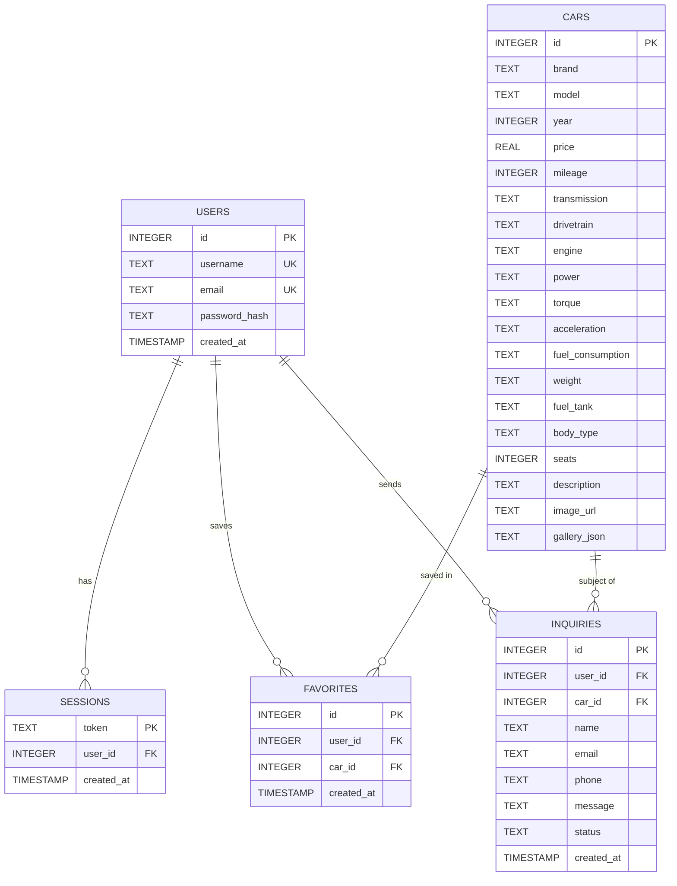

# DriveFind — Маркетплейс автомобилей с пробегом

Учебный проект по дисциплине **«Введение в интернет-технологии»**.

- **Вариант:** № 11 (Группа А: Каталог и подбор)
- **Тема:** Магазин автомобилей
- **Особенность проекта:** Фильтр по бюджету, году, пробегу
- **Страница действия:** Сравнение автомобилей (`compare.html`)

---

## 📌 Оглавление
1. [Выполненные практические работы](#выполненные-практические-работы)
   - [Практическая работа № 1 (HTML, CSS)](#практическая-работа--1-html-css)
   - [Практическая работа № 2 (JavaScript, fetch, API)](#практическая-работа--2-javascript-fetch-api)
   - [Практическая работа № 3 (Python, FastAPI, SQLite, Auth)](#практическая-работа--3-python-fastapi-sqlite-auth)
2. [Структура базы данных](#структура-базы-данных)
3. [Список эндпоинтов API](#список-эндпоинтов-api)
4. [Инструкция по запуску](#инструкция-по-запуску)
5. [Тестовая учетная запись](#тестовая-учетная-запись)

---

## 🚀 Выполненные практические работы

### Практическая работа № 1 (HTML, CSS)
- **5 связанных страниц:**
  - `index.html` — Главная: назначение сайта, слоган, меню, подборка популярных автомобилей.
  - `catalogue.html` — Каталог автомобилей с 12+ позициями и блоком фильтрации.
  - `item.html` — Карточка автомобиля (Mazda MX-5 Miata) с фото, описанием, ценой и подробными характеристиками.
  - `compare.html` — Страница действия для группы А: детальное сравнение двух автомобилей в параллельных колонках.
  - `contacts.html` — Контакты: адрес, телефон, часы работы, слоган и форма обратной связи.
- **Семантическая разметка:** `<header>`, `<nav>`, `<main>`, `<section>`, `<article>`, `<footer>`.
- **Иерархия заголовков:** ровно один тег `<h1>` на каждой странице.
- **Доступность:** у всех изображений заполнены осмысленные атрибуты `alt`.
- **Оформление и адаптивность:**
  - Стили вынесены в `style.css` (без inline-стилей).
  - Макет на базе Flexbox и CSS Grid.
  - Корректное отображение на экранах от **360px** без горизонтальной полосы прокрутки.

### Практическая работа № 2 (JavaScript, fetch, API)
#### Часть 1. Поведение и интерактивность:
1. **Интерактивные формы:**
   - **Форма обратной связи (`contacts.html`):** клиентская валидация полей (имя, корректный email по регулярному выражению, длина сообщения). Сообщения об ошибках выводятся непосредственно **рядом с полями** в красном цвете, без использования `alert()`.
   - **Форма фильтрации каталога (`catalogue.html`):** валидация числовых значений (макс. цена > 0, год в диапазоне 1900–2026, неотрицательный пробег).
2. **Элементы, меняющие содержимое без перезагрузки страницы:**
   - **Динамический фильтр и сортировка:** список автомобилей на странице каталога фильтруется и сортируется в реальном времени без перезагрузки DOM.
   - **Фотогалерея (`item.html`):** интерактивное переключение ракурсов автомобиля кнопками `<` и `>` со стильными точками-индикаторами (3 фото одного поколения на каждое авто).
   - **Мягкая автокоррекция фильтров (`catalogue.html`):** автоматическая синхронизация минимальных и максимальных значений (Min > Max подтягивает Max, а Max < Min опускает Min без ошибок).

#### Часть 2. Внешние данные (API):
1. **Погода на площадке автосалона (Open-Meteo API, `contacts.html`):**
   - Получение текущей температуры и погодных условий для проведения тест-драйва через асинхронный `fetch()`.
   - Индикатор статуса загрузки («Загрузка прогноза...»).
   - **Устойчивость к сбоям:** при отключении интернета страница выводит понятное сообщение и продолжает полноценно работать.

### Практическая работа № 3 (Python, FastAPI, SQLite, Auth)
- **Стек:** Python 3, FastAPI, SQLite, Uvicorn, Pydantic, Bcrypt.
- **База данных SQLite:** спроектирована структура из 5 связанных таблиц, поддерживающих внешние ключи и каскадное удаление.
- **Наполнение базы:** 16 детализированных записей автомобилей с техническими характеристиками (требование: не менее 15).
- **Безопасность:**
  - Пароли хранятся исключительно в виде криптографического хеша (`bcrypt` с автоматической солью).
  - Все SQL-запросы на 100% **параметризованные** (`?`), строковая конкатенация исключена.
- **Учетные записи:** регистрация и авторизация пользователей с генерацией сессионных токенов.
- **Защищенный контент:** авторизованный пользователь получает доступ к персональному разделу «⭐ Мое избранное» и может сохранять автомобили кликом по сердечку на карточках.

---

## 🗄 Структура базы данных



### Описание таблиц:
1. `users` — учетные записи (id, уникальный логин, уникальный email, bcrypt-хеш пароля, дата регистрации).
2. `cars` — каталог автомобилей (16 моделей с полной спецификацией: двигатель, л.с., разгон, расход, масса и т.д.).
3. `favorites` — связь «многие-ко-многим» между пользователями и сохраненными машинами (`user_id` -> `users.id`, `car_id` -> `cars.id`).
4. `inquiries` — заявки с формы обратной связи и бронирования тест-драйвов.
5. `sessions` — активные токены пользовательских сессий.

---

## 🔌 Список эндпоинтов API

| Метод | Путь | Описание | Доступ |
|---|---|---|---|
| `GET` | `/api/health` | Проверка работоспособности сервиса | Публичный |
| `GET` | `/api/cars` | Получение списка автомобилей с фильтрами (`max_price`, `min_year`, `max_mileage`, `sort`) | Публичный |
| `GET` | `/api/cars/{id}` | Детальная информация об одном автомобиле | Публичный |
| `POST` | `/api/auth/register` | Регистрация нового пользователя | Публичный |
| `POST` | `/api/auth/login` | Вход пользователя (проверка пароля по bcrypt) | Публичный |
| `GET` | `/api/auth/me` | Получение данных текущего пользователя | Авторизованный |
| `POST` | `/api/auth/logout` | Завершение сессии | Авторизованный |
| `GET` | `/api/favorites` | Получение списка избранных авто пользователя | Авторизованный |
| `POST` | `/api/favorites/{car_id}` | Добавление автомобиля в избранное | Авторизованный |
| `DELETE` | `/api/favorites/{car_id}` | Удаление автомобиля из избранного | Авторизованный |
| `POST` | `/api/inquiries` | Отправка сообщения / заявки на тест-драйв | Публичный / Пользователь |

Интерактивная документация Swagger доступна по адресу: `http://127.0.0.1:8000/docs`.

---

## 🛠 Инструкция по запуску

### Способ 1: Полнофункциональный запуск (FastAPI + Frontend)

1. **Создайте и активируйте виртуальное окружение Python (если еще не создано):**
   ```bash
   python3 -m venv venv
   source venv/bin/activate
   ```

2. **Установите зависимости:**
   ```bash
   pip install -r requirements.txt
   ```

3. **Инициализируйте базу данных SQLite:**
   ```bash
   python3 database.py
   ```
   *Скрипт создаст таблицы и наполнит базу 16 автомобилями, а также создаст демо-пользователя.*

4. **Запустите сервер:**
   ```bash
   python3 server.py
   ```
   или:
   ```bash
   uvicorn server:app --reload --port 8000
   ```

5. **Откройте приложение в браузере:**
   ```
   http://127.0.0.1:8000
   ```
   - Swagger документация API: `http://127.0.0.1:8000/docs`

---

### Способ 2: Запуск через Docker (Практическая работа № 4)
Проект полностью упакован в легковесный Docker-контейнер и собирается одной командой:
```bash
# 1. Сборка контейнера
docker build -t drivefind .

# 2. Запуск контейнера
docker run -p 8000:8000 drivefind
```
После запуска сайт доступен по адресу: `http://localhost:8000`.

---

### Способ 3: Запуск только статического фронтенда (ПР 1 и ПР 2)
Если запуск сервера не требуется, все страницы фронтенда работают автономно из папки `internet/`:
- Достаточно открыть любой HTML-файл (например, `internet/index.html`) в любом браузере или через Live Server.
- При отсутствии сервера фронтенд автоматически переходит в оффлайн-режим с использованием локального резервного каталога.

---

## 🔑 Тестовая учетная запись

Для проверки авторизации и защищенного раздела «Избранное»:
- **Логин:** `demo`
- **Пароль:** `demo123`

Также можно зарегистрировать нового пользователя через форму в шапке сайта.
